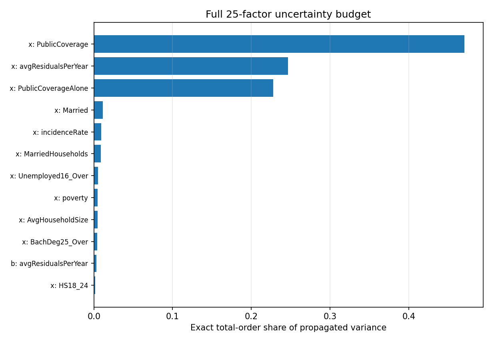
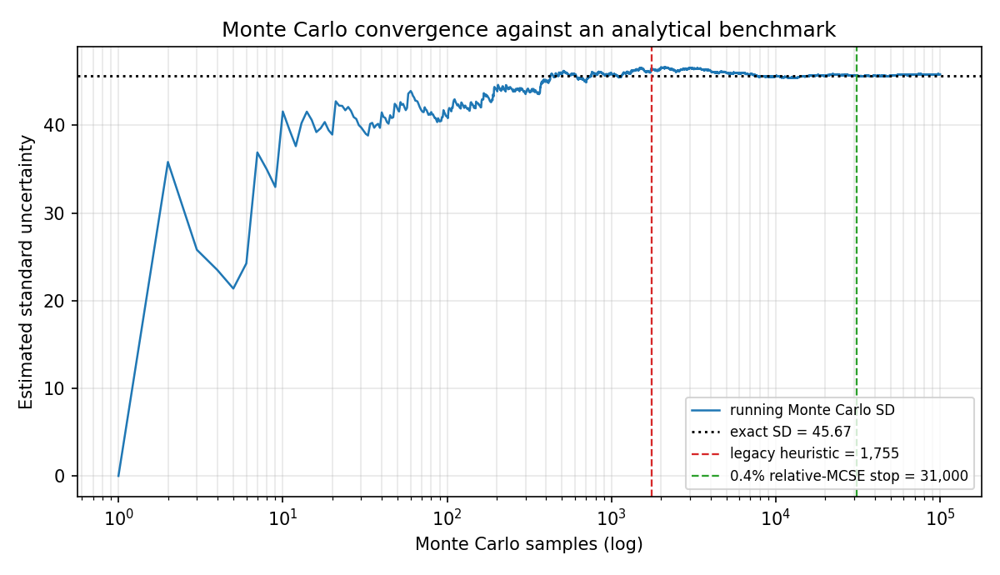
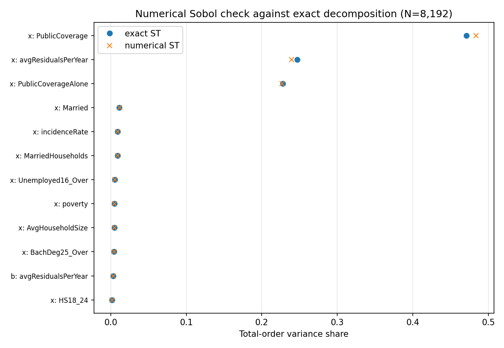
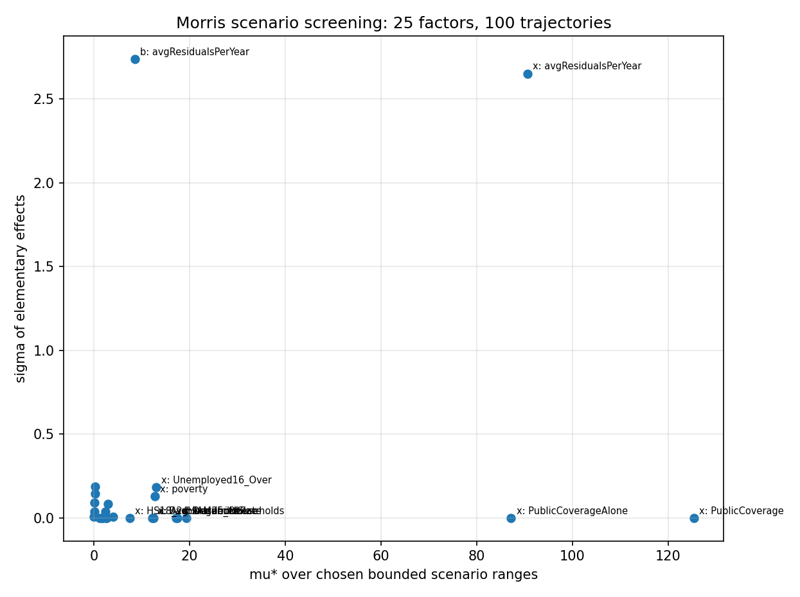
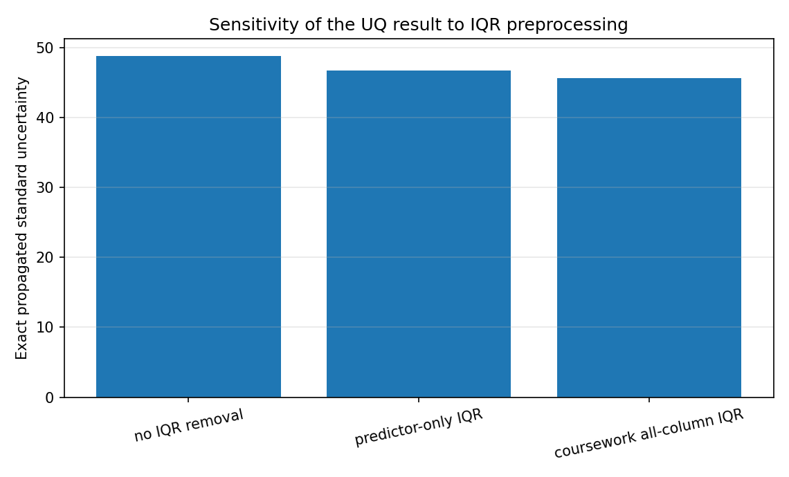

# TB Regression Uncertainty Budget — Monte Carlo, Exact Variance and Sensitivity

[](https://github.com/AhmadEblagh205/tb-uncertainty-analysis/actions/workflows/ci.yml)


A tested reconstruction and audit of my UCL BENG0091 uncertainty-analysis coursework: a linear regression on county-level TB-demographic data, Monte Carlo propagation of the coursework uncertainty budget, exact analytical variance decomposition, numerical Sobol validation and Morris screening.

The most important v2 lesson is methodological: **a sensitivity analysis is only meaningful if it uses the same factor set and uncertainty definitions as the model whose uncertainty it claims to explain.** The earlier rebuild varied 18 predictor inputs in Monte Carlo but only 6 of them in Sobol/Morris. Fixing that changes the headline sensitivity result.

The real coursework dataset was supplied inside the module and is **not redistributed**. Derived aggregate reports are included; all code and tests also run with a deterministic synthetic schema fixture. This is a coursework uncertainty study, not an epidemiological prediction system.

## What changed in the audit

The original coursework cleaning is preserved: a row is removed when any column, including the target, falls outside a 1.5-IQR fence. On the authorised dataset this reduces **3,047 rows to 2,050**, matching the notebook. V2 additionally measures how much that preprocessing choice changes the final uncertainty result instead of treating it as invisible.

The propagated model contains **25 independent uncertain factors**: 18 input-variability factors plus seven relative coefficient/intercept biases. Earlier Sobol/Morris code used only 13 factors, omitting 12 predictor-variability terms that the Monte Carlo simulation did vary. That mismatch made `avgResidualsPerCapitaPerYear` appear to carry about 99% of the variance. It does not under the full propagated budget.

Because the fitted model is linear and the bias terms are simple multiplicative factors, the variance can be decomposed **exactly**. Under the coursework all-column cleaning:

| Exact total-order contributor | Share |
|---|---:|
| `PublicCoveragePerCapita` input variability | **47.09%** |
| `avgResidualsPerCapitaPerYear` input variability | **24.68%** |
| `PublicCoverageAlonePerCapita` input variability | **22.78%** |

Those three factors explain about **95.3%** of propagated variance. All input:bias interactions together contribute only about **0.013%** under the stated assumptions.



## Monte Carlo now has a truth benchmark

A 100,000-draw run gives:

- Monte Carlo standard uncertainty: **45.828**;
- exact analytical standard uncertainty: **45.665**;
- relative difference: **0.36%**;
- exact `k=2` expanded uncertainty under this scenario: **91.330**.

This is stronger than simply quoting a simulation result because the numerical implementation is checked against an independent closed form.

The old adaptive rule also turned out to be too optimistic. It stopped after roughly **1,755** samples because consecutive running-SD updates were each changing by less than 0.4%; however, the estimated relative Monte Carlo error of the SD was still about **1.72%**. A direct 0.4% relative-MCSE criterion is not reached until about **31,000** samples in the reference run.



That distinction is worth making explicit:

> **a slowly changing estimator is not automatically a precisely estimated estimator.**

## Sobol and Morris, now scoped correctly

Numerical Sobol uses the same **25 factors and distributions** as the Monte Carlo propagation. At 8,192 base samples (**221,184 model evaluations**), the maximum total-order-index error versus the exact decomposition is about **0.013** in the reference run.



Morris also now screens all 25 factors, but it is deliberately described as a **bounded scenario screen** rather than a probability-based variance decomposition. Its leading ranking agrees with the exact budget: public-coverage variability, average-residual variability and public-coverage-alone variability dominate.



## Preprocessing is part of the uncertainty analysis

The original all-column IQR rule uses the target when deciding which rows remain. V2 preserves it for coursework reproducibility and separately reports a sensitivity audit:

| Preprocessing | Rows | Exact propagated SD |
|---|---:|---:|
| no IQR removal | 3,047 | **48.816** |
| predictor-only IQR | 2,067 | **46.686** |
| coursework all-column IQR | 2,050 | **45.665** |

The original cleaning therefore lowers the propagated SD by about **6.45%** relative to no IQR removal in this dataset. I do not treat that as proof that one preprocessing choice is epidemiologically correct; it shows that **preprocessing assumptions belong inside the uncertainty discussion**.



## What the uncertainty means

The propagated distribution is a result of the **coursework uncertainty scenario**. It is not a county-level predictive interval and it is not a calibrated public-health uncertainty statement. In particular, the current propagation does not include regression residual/model discrepancy, coefficient-estimation uncertainty or dependence between predictor perturbations.

The bias magnitudes also need careful terminology: the normal distribution parameter is a standard deviation, whereas uniform and triangular parameters are half-widths. V2 therefore calls them **distribution scales**, not all “standard uncertainties”.

See [`docs/METHODOLOGY.md`](docs/METHODOLOGY.md) for the derivation.

## Usage

```bash
pip install -r requirements.txt

# Fully offline synthetic-schema run
python src/mcm.py --synthetic
python src/variance_budget.py --synthetic
python src/sobol.py --synthetic --base 4096
python src/morris.py --synthetic
python src/cleaning_sensitivity.py --synthetic

# With your authorised coursework file at data/raw/TB_demographics.csv
python src/mcm.py
python src/variance_budget.py
python src/sobol.py
python src/morris.py
python src/cleaning_sensitivity.py
```

## Tests

`pytest -q` currently runs **12 tests** covering IQR behaviour, the distinction between target-aware and predictor-only cleaning, running variance, the legacy and MCSE stopping rules, bias-distribution parameterisation, the full 25-factor budget, exact-vs-Monte-Carlo agreement, unit-cube distribution transforms, Sobol recovery and Morris trajectory structure.

## Provenance

The original notebook is preserved under `notebooks/`. The county dataset is not shipped; see `data/README.md`. The synthetic generator is an engineering fixture only and must not be described as epidemiological data.

The v2 result should be read as: **given the stated coursework uncertainty scenario and independence assumptions, the analytical and numerical uncertainty calculations agree, and the corrected full-factor sensitivity ranking is very different from the old restricted-factor ranking.**

## Licence

MIT, see [LICENSE](LICENSE).
